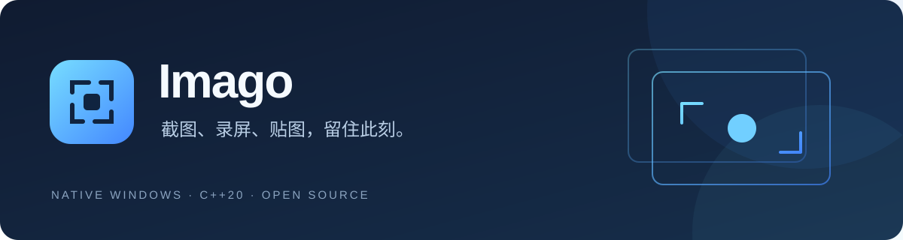

<div align="center">



**一个轻巧的 Windows 原生截图与录屏工具。**

[](https://github.com/versescribe/Imago/releases/latest)
[](https://github.com/versescribe/Imago/actions/workflows/ci.yml)
[](https://github.com/versescribe/Imago/releases/latest)
[](CMakeLists.txt)
[](LICENSE)

[**下载最新版**](https://github.com/versescribe/Imago/releases/latest) · [使用指南](docs/USAGE.md) · [更新日志](CHANGELOG.md) · [反馈问题](https://github.com/versescribe/Imago/issues)

</div>

## 留住画面，也留出空间

Imago 把截图、标注、文字识别、长截图、贴图和区域录屏放进一套简洁的原生界面。
使用 C++20 与 Windows 系统能力，无需安装 .NET、Electron、FFmpeg 或其他第三方运行时。
不需要账号，截图、OCR 与录屏在本地处理。

| 截取 | 编辑 | 留存 |
| :--- | :--- | :--- |
| 自由框选、窗口吸附、多屏截图 | 箭头、矩形、椭圆、文字、实色遮盖 | PNG 保存、复制到剪贴板 |
| 自动／手动双向滚动长截图 | 像素马赛克、模糊马赛克、撤销重做 | 置顶贴图、缩放与透明度 |
| 区域录屏、暂停、分辨率与帧率 | 取色器、系统 OCR 文字复制 | MP4 播放、复制文件与另存 |

截图与录屏拥有独立入口，选区工具栏左端可以切换模式。录屏的电脑音频、麦克风**默认关闭**，需要时分别选择设备。
界面跟随系统深浅色和高对比度，支持系统／自定义强调色、快捷键与可选开机自启。

## 开始使用

1. 在 [Releases](https://github.com/versescribe/Imago/releases/latest) 下载 `Imago-版本号-windows-x64.zip`。
2. 解压后运行 `Imago.exe`，无需安装。关闭主窗口后仍驻留托盘。
3. 按 **Ctrl + Alt + A** 截图，或从主窗口直接开始录屏。

| 常用操作 | 默认快捷方式 |
| :--- | :--- |
| 框选截图 | `Ctrl + Alt + A` |
| 剪贴板贴图 | `Ctrl + Alt + P` |
| 复制截图 | `Enter` / `Ctrl + C` |
| 保存截图 | `Ctrl + S` |
| OCR 识别复制 | `Ctrl + Shift + C` |
| 滚动长截图 | `Ctrl + Shift + S` |
| 取消当前操作 | `Esc` |

更多标注、录屏和贴图操作见 [使用指南](docs/USAGE.md)。

**系统要求：** Windows 10 2004 或更高版本、Windows 11，x64。录屏需要系统媒体组件及兼容的图形驱动；OCR 使用已安装的 Windows 语言能力。

## 更新与隐私

主窗口和托盘提供「检查更新」。默认在启动后检查，自动检查间隔至少 24 小时，可在设置 → 常规关闭。
检查只读取公开 GitHub Release 信息，发现新版本后由你打开下载页；**不会自动下载、安装或上传截图、文字和录音**。

更新前先从托盘退出旧版，再解压替换。设置保存在 `%LOCALAPPDATA%\Imago`；移动 EXE 后若使用开机自启，请重新保存该设置。
录屏暂存文件会保留，便于复制后继续粘贴，可从托盘打开目录手动清理。详见 [隐私与本地数据](docs/PRIVACY.md)。

## 从源码构建

准备 Visual Studio 2022「使用 C++ 的桌面开发」、CMake 组件和 Windows SDK 10.0.22621 或更高版本，在 PowerShell 执行：

```powershell
git clone git@github.com:versescribe/Imago.git
Set-Location Imago
./tools/build.ps1
```

默认仅编译 Release 和打包，不启动应用或测试。产物位于 `dist/`，包含便携 ZIP 和 SHA-256 文件。
如需执行无界面的核心测试，使用 `./tools/build.ps1 -RunTests`。

```text
src/          原生窗口、截图、OCR、长截图、录屏、更新检查
resources/    图标、Win32 资源与应用清单模板
tests/        图像数据与更新元数据测试
tools/        PowerShell 构建和发布辅助脚本
docs/         使用指南、架构、隐私与发布说明
VERSION       唯一版本来源
```

技术细节见 [架构说明](docs/ARCHITECTURE.md)。代码与协作约定见 [CONTRIBUTING](CONTRIBUTING.md) 和 [AGENTS](AGENTS.md)。

## 当前边界

首个公开版本为 **0.0.1**，仍在打磨。CI 验证构建和核心逻辑，不能替代真实设备上的录屏、音频、多屏和 DPI 验证。

- 录屏限单显示器内的固定区域，面向 SDR；暂不支持视频编辑和 macOS。
- Windows 可能显示整块显示器的黄色采集提示；Imago 按选区裁剪输出，并额外显示实际范围边框。
- 视频复制使用文件剪贴板格式，需要目标应用支持文件粘贴。
- 滚动长截图依靠画面重叠匹配，快速跳页、固定浮层或动态内容可能影响拼接。
- 当前发行包未做 Authenticode 签名；SHA-256 文件用于核对下载完整性，不代表代码签名。

## 开源

Imago 使用 [MIT License](LICENSE)。欢迎提交可复现的问题和范围清晰的 PR。
发布由 GitHub Actions 完成：推送与 `VERSION` 一致的 `vX.Y.Z` 标签，即构建并发布便携包。详见 [发布流程](docs/RELEASING.md)。
